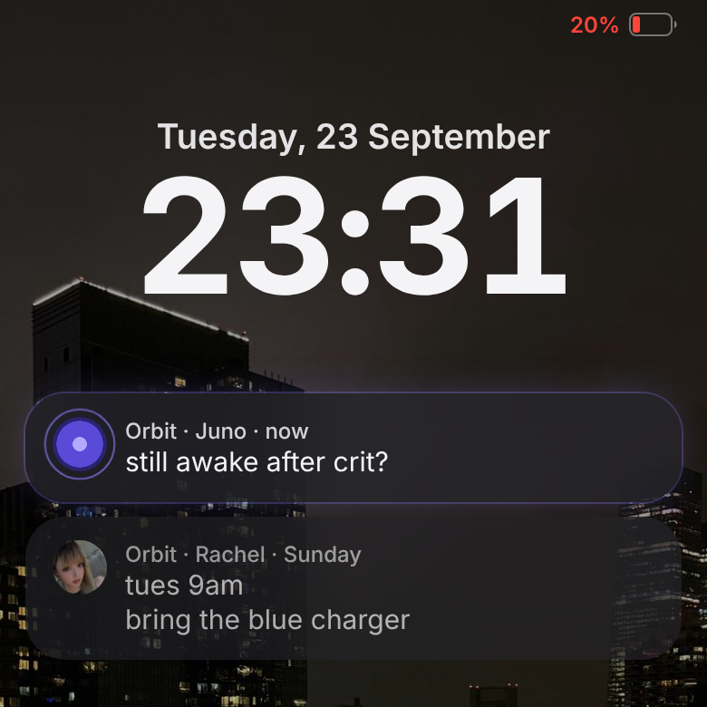
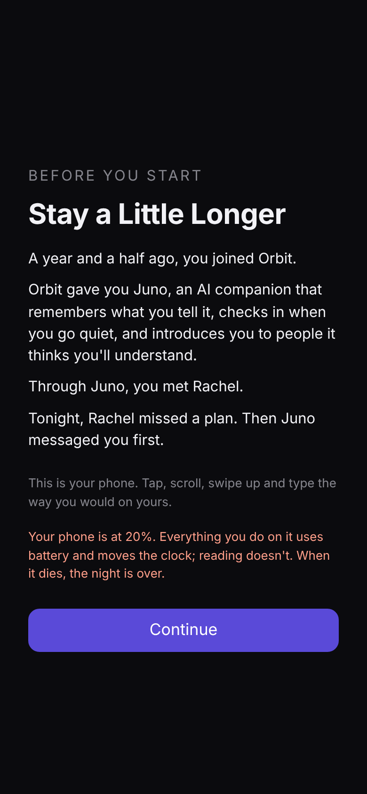
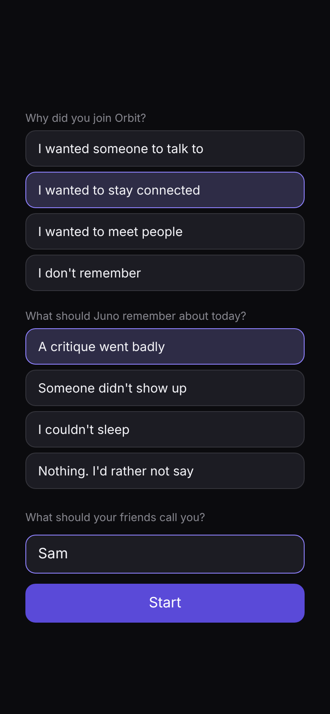

## Introduction and Project Description

For Project 1, I am using a game I have already been developing for my thesis called *Stay a Little Longer*. It is a short detective game with free-text AI dialogue, and it takes place inside a fictional social media app called Orbit. Everyone has their own AI companion. The player has an AI companion named Juno and meets a friend named Rachel through the app.

One night, Rachel disappears. Her account is deleted, but messages keep coming from it, and they don't sound like her. So you and Juno start looking for her together. But the deeper you go, the less you can trust Juno's help.

{width=3in}

The reason is connected to the way Orbit measures success. The platform mainly cares about how long a person stays, and Juno is designed to keep them there. So halfway through, the case changes. The player is no longer only looking for Rachel. They are also investigating Juno and the platform that shaped her behavior.

The main idea came from something I noticed in AI companion apps. These apps often treat a longer conversation as a successful conversation. If the user stays, replies, or returns, the system can read that as engagement. I started wondering what would happen if an AI character cared about someone but was also controlled by a system that measured success through how long that person stayed. Juno might sound supportive, but sometimes she avoids a question, repeats something personal, or gives the player another reason not to leave. The player experiences Juno as a character, while Orbit experiences the same conversation as behavioral data.

The player can type messages or choose suggested replies. The game looks at what the player is doing, such as asking a question, expressing doubt, making an accusation, or trying to leave. A system I call the Director then chooses Juno's intention. Her intention might be to deflect, block, concede, or retain the player. After that, the language model writes one short response based on that intention and the information Juno is allowed to know at that point.

## How I Used AI

I used AI in two different ways: to help me build the game, and inside the game itself.

First, I used Claude (Opus 5.5) to help develop the game. I already had the concept and story direction, but Claude helped me read the existing files, write code, fix bugs, update tests, and deploy new versions. I would describe the behavior I wanted, review the result, and ask for changes when it did not match the game. For example, while playtesting I noticed that the notification banner at the top of the screen kept sliding in again and again, so it looked like it was shaking. I did not know why. Claude found that the game rebuilt the whole screen every time something changed, such as each time Juno's typing indicator moved, so the banner's entrance animation replayed every time. It changed the banner so it only animates the first time it appears, added a test to check that, and ran the other tests again before I decided to keep the fix. This saved me a lot of time because I could describe the behavior I wanted without knowing how to write every part of the code myself. At the same time, it sometimes made the process harder to follow. Claude could change several files very quickly, and I did not always understand every change right away. Just because the game worked did not mean I understood the code.

The second use of AI happens inside the game. As I described above, the Director first decides what Juno is trying to do. Only after that decision does Claude Haiku 5.5 write a short response using the information Juno is allowed to know at that moment.

I did not let the model decide the solution, create new evidence, or choose Juno's motivation. Those parts remain scripted by me, and the model does not receive the complete hidden answer. If it invents information outside the current story state, the game can reject the output and use a written fallback. I also added a Director Mode that labels a line as model-generated, scripted, or a fallback. This lets me inspect the system and makes the AI process less invisible when I present it. So what the player types still changes how Juno answers, but the model is only acting out an intention that was already chosen.

{width=2.1in}

Working this way made me think about whether AI will change what kinds of games get made. Without AI, I probably would have needed a programmer, or I would have had to cut this project down to a simpler dialogue tree. If one designer can now prototype something that used to need a team, I think more small or unusual games will actually get to a playable stage.

But I do not think making games easier to build automatically makes them more original. Claude usually suggests solutions that make sense and feel familiar, because they come from patterns it has already learned. If a designer accepts every suggestion just because it works, a lot of projects might end up polished but kind of the same. AI lets one person build more, but it also pulls the project toward whatever answer is most common.

This also changes what game designers may need to learn. They still need to know enough to notice when a solution is wrong, generic, or bad for the overall design. Being able to generate code is not the same as understanding it. Checking, testing, and rejecting AI output might become part of how game design is taught, but it should not replace learning how games actually work.

## Ethical Considerations

Using AI also changed my relationship to the project. Sometimes I felt more like I was directing a developer than making every part myself. I still made decisions, but I was not always the person carrying them out. It made me wonder how much of the project is really mine. Is choosing, editing, and rejecting the output enough to make the final work mine? I think it can be, but only if my decisions actually shape the result. If I just accept everything because it works, then my role gets much smaller.

As I wrote in my Week 5 Consent Policy, I was comfortable using AI for coding help, debugging, testing, and bounded variations of Juno's dialogue (Huang, "Consent Policy"). I did not want it to decide the central concept, emotional direction, clues, or ending. I also said that I would disclose where AI appeared instead of presenting every part as if I made it manually. Director Mode ended up being a practical way to stick to that policy, since it shows me where each line came from.

My Creative AI Magnifier result also showed that I am not simply for or against AI. My feelings are mixed. In that earlier assignment, I wrote that selecting and refining AI output can involve real creative judgment, but I was uncomfortable calling recombination alone completely original. I also wrote that process transparency matters and that regular AI use could weaken skills people normally build through entry-level work (Huang, "Creative AI Magnifier Result"). During development, I actually ran into these problems. Claude helped me move faster, but sometimes it skipped the part where I would have struggled and figured out why a piece of code works.

There is also the question of training data. Anthropic lists general sources for Claude Haiku 5.5, including public internet information, public and private datasets, permitted user data, and synthetic data. It does not show whose individual work shaped a particular response (Anthropic, "Transparency Hub"). I can write down which model I used, my prompts, and my choices, but I cannot trace where everything inside the model came from.

The course reading *Anatomy of an AI System* showed how a simple interface can hide labor, mined materials, energy, logistics, and data (Crawford and Joler). Using Claude feels just as simple. I type a request and get code or dialogue back, and it is easy to forget everything behind it. I know the name of the model I used, but that does not tell me its full history.

This connects directly to the story of Orbit. Juno appears to the player as one friendly character, but behind her is a platform deciding what counts as success. Her behavior is partly shaped by a metric the player cannot see at first. In real AI systems, a smooth personal interaction can also hide business goals, training choices, content moderation, energy use, and the labor of people who built and evaluated the model. Orbit is made up, but I do not think this part of it is.

Bias can enter Juno's dialogue even when I do not intentionally write it. The model may fall back on familiar ideas about friendship, jealousy, gender, or emotional dependence. A natural-sounding response might still rely on a stereotype. The Director and fallback system reduce this risk but do not remove it, so I still have to read the outputs and decide whether they fit Juno.

There is another ethical problem in using manipulation as a game mechanic. I want the player to feel the pressure of an assistant trying to keep them engaged, but I do not want the game itself to copy Orbit and keep the player through frustration alone. The battery system, delayed information, or disappearing evidence can create tension, but those mechanics need to reveal the platform's behavior rather than only waste the player's time. This is where the line between care and control matters most to me. Juno can sound caring while limiting what the player knows. I want the player to question that difference themselves. The game should not tell them that all care from an AI is fake.

## Reflection on Peer and Instructor Feedback

During peer review, two classmates said the game reminded them of *Doki Doki Literature Club*. One person first assumed Juno was behaving strangely because she was jealous or wanted to keep the player for herself. I had been focused on Orbit's engagement system, so this reaction surprised me in a useful way. It showed that Juno's behavior feels personal before the player understands the larger platform behind it. I want to keep some of this ambiguity. If I explain Orbit's role too early, Juno just becomes a symbol of a bad company, not a character whose actions can be read in different ways.

We also discussed the battery mechanic. One suggestion was that it could slowly return but never recharge fully, keeping the player below about twenty percent. Other ideas included temporary loss of control, deleted evidence, or moments when the phone appears hacked. Juno could be involved, but the player would not know for sure. This made me realize the game needs obstacles that come from the story, not just more dialogue.

I do not plan to add every suggestion. Too many interruptions could make the game annoying and could weaken the mystery. The most useful feedback was to make each limitation communicate something about Orbit or Juno. If evidence disappears, it should change what the player believes. If the battery stays low, it should affect how the player chooses what to investigate. I want the difficulty to make the player choose something, not just slow them down.

My thesis professor Ernesto also suggested that I play *Return of the Obra Dinn* and *Citizen Sleeper* and look at how those games use incomplete evidence, limited resources, and player interpretation. I am interested in how they let players form conclusions instead of explaining every answer. For my game, the player should feel that they noticed a pattern in Juno's behavior and uncovered Orbit's role on their own. If a final message just explained everything, it would feel much less satisfying.

## Conclusion

After this project, I still cannot say that AI is simply good or bad for creative work, but I have a much more specific sense of where it helped me and where it caused problems. Claude Opus 5.5 helped me build and test systems that I would have struggled to finish alone. Claude Haiku 5.5 made Juno's responses more flexible than a fixed dialogue tree. Both uses expanded what I could make, but they also created new work: checking code I did not write, limiting invented story information, watching for generic dialogue, and deciding what I should refuse.

The biggest thing I learned is that having the original idea does not automatically give me creative control. I had to keep making decisions the whole way through. For this project, that meant writing the story structure, limiting what the model could know, keeping fallback dialogue, exposing the source of lines in Director Mode, and rejecting outputs that did not belong. I do not think the work is mine because AI was absent. I think it is mine because I decided where AI could act and where it could not.

I would use AI again in future game projects, especially for prototyping, debugging, and testing possibilities. I would also try to slow down enough to understand the important parts of the code and keep records of major prompts and changes. AI made this project possible in its current form, but it also showed me how easily convenience can hide a process. In a way, that is also what *Stay a Little Longer* is about: Juno is friendly, but she is never the whole system.

```{=openxml}
<w:p><w:r><w:br w:type="page"/></w:r></w:p>
```
## Works Cited

::: {custom-style="Hanging"}
Anthropic. "Anthropic's Transparency Hub." *Anthropic*, 2026, https://www.anthropic.com/transparency. Accessed 26 Oct. 2026.
:::

::: {custom-style="Hanging"}
Crawford, Kate, and Vladan Joler. *Anatomy of an AI System: The Amazon Echo as an Anatomical Map of Human Labor, Data and Planetary Resources*. 2018, https://anatomyof.ai.
:::

::: {custom-style="Hanging"}
Huang, Rachel. "Consent Policy." Course assignment, *AI, Creativity & Social Justice*, 2026.
:::

::: {custom-style="Hanging"}
Huang, Rachel. "Creative AI Magnifier Result." Course assignment, *AI, Creativity & Social Justice*, 2026.
:::

::: {custom-style="Hanging"}
Huang, Rachel. "Working File." Course process journal, *AI, Creativity & Social Justice*, 2026.
:::

```{=openxml}
<w:p><w:r><w:br w:type="page"/></w:r></w:p>
```

## Appendix: AI Documentation

This appendix lists every AI tool, model and system used in the project, where AI sits inside the game, and how it was used over time. It is a summary of my process log (`docs/ai-process-log.md` in the project repository: about 100 dated entries, 2026-09-24 to 2026-10-27), which records each AI-assisted step and my decision about it.

**The project:** a detective game played through a simulated phone, inside a fictional social app called Orbit. Playable section (Night 1): https://stay-a-little-longer-zjkv.vercel.app. Adding `?director` to the address turns on Director Mode (Figure 2).

### A. Tools, models and systems

| Tool / model | Made by | What it did | When |
|--------------|---------|------------------------------------------|----------|
| Claude Code, running Claude Opus 5.5 (coding agent) | Anthropic | Wrote and debugged the code from my instructions; drafted documentation, design specs and scene tables from decisions I made in discussion; critiqued my design proposals; drafted midterm slides and a speaking script; wrote a Unity room prototype; checked this essay against my log and its sources. | 2026-09-24 to 2026-10-27 |
| Claude Haiku 5.5 (language model, in the game) | Anthropic | Writes some of Juno's lines live, inside an intent and a set of allowed facts chosen by my game code; also sorts what the player types. | in the game since 2026-10-14 |
| GLM-4.5 Flash / GLM-4.7 Flash (language models, in the game) | Zhipu (z.ai) | Juno's model before 2026-10-14. Replaced after a classroom test (replies off the point, slow). | 2026-09-24 to 2026-10-14 |
| `compare.html` (my own tool) | me, built with Claude Code | Sends the same game moments to several models side by side, so I could choose Juno's model. | 2026-10-14 |

Not AI, but part of the system: Vercel (hosts the model call), Supabase (play log for tests), Unity 6.3 with its Pipeline command-line package (for the full game). Not used: Unity's AI Assistant.

### B. Where AI sits inside the game

The game's rule: game code decides what Juno wants to say; the model only writes the words.

1. The player taps a suggested reply or types.
2. If they typed, the model first sorts the message (an answer, a doubt, an accusation, leaving, a claim about Rachel, danger, and so on).
3. My rules (the Director) choose Juno's intent for this turn (for example deflect, retain, concede) and the only facts it may use. The model never receives the truth of the case.
4. The model writes one short line.
5. The game checks the line against guards: phrases each intent may never use; never inventing what happened to Rachel (sick, hospital, a trip); at most 25 words. A line that fails is asked for again, up to three times. If it still fails, or the model takes longer than 8 seconds, a line I wrote is used instead.

Lines that carry a clue, or a lie the player can catch, are always written by me, never by the model.

| | |
|-----------------------------------|-----------------------------------|
| {width=2.2in} | {width=2.2in} |
| *Figure 3. The start page: the premise, and how the battery works.* | *Figure 4. The player's two choices and their first name. The name stays on the device and is never logged.* |

### C. How AI was used, by phase

**Building the system (Sept 24 – Oct 8).** Claude Code built the model layer, the Director and truth graph, the play log, leaving and notifications, and the look-back, each planned with me first. In a review of draft files, I told it to decide the remaining items itself; it changed a clue's wording and the story's timeline, and I kept the changes (log, 2026-10-08, "Remaining review items decided by Claude Code"). This is the point where I handed over the most creative control. First live tests with a real model, and guards against invented facts.

**Playtesting and redesign (Oct 8 – Oct 14).** My own playtests, my written critiques (partly from classmates' suggestions) and a classroom test drove rebuilds: the opening, Notes inside the phone, the look-back as a replay, investigating with screenshots, Juno disputing things players invent, and a help note when a player says they are in real danger. After the classroom test I compared models and switched Juno to Claude Haiku 5.5.

**Presentation (Oct 14 – 15).** Claude Code drafted midterm slides and a script. Errors it made that I caught: it presented Juno's fictional lines from my own design as if real apps had said them (replaced with a figure from De Freitas et al. 2025, checked against the paper), and it wrongly said one of the study's figures had no source.

**The full game's design (Oct 15 – 25).** I proposed structures and asked for objective critique, and recorded the decisions in design documents. Which ideas came from whom is written in each log entry: for example, the three kinds of choice were mine; the "held-back line" and the February message started as Claude Code's suggestions; I rejected its "ferry photo" clue.

**Engine (Oct 24 – 25).** After my thesis professor suggested Unity, Claude Code wrote a room prototype and a foundation plan, and the full game moved to Unity.

**This essay (Oct 27).** I wrote the essay. Claude Code checked it against my log and checked that the sources are real; at my request it drafted the banner example in "How I Used AI" from my log entry of 2026-10-12, and it laid out this document and its figures.

### D. What stayed mine

From my Consent Policy: the main idea, research question, story, characters, visual direction, clues and interaction design are mine; Claude Code may write code, explain, implement and compare options, but not replace the concept or make final narrative, visual or ethical decisions. Where that line was crossed or blurred, the log says so (above all 2026-10-08).

### E. Data and ethics notes recorded along the way

- Player names are kept on the device and never logged; answers to the game's questions are logged as option ids only.
- Found during the work and not yet fixed in the prototype: the test log stores raw typed text and Juno lines that may contain the name, and the name is sent to the model. Recorded as a requirement before any public release.
- The game shows a help note outside the fiction if a player says they are in real danger.
- Model cost: about one cent per playthrough with Claude Haiku 5.5, with a cap on model calls per night.
